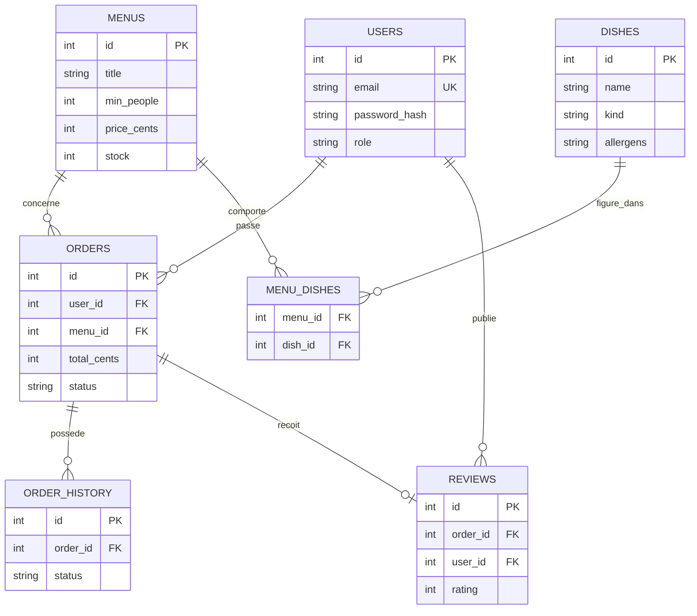
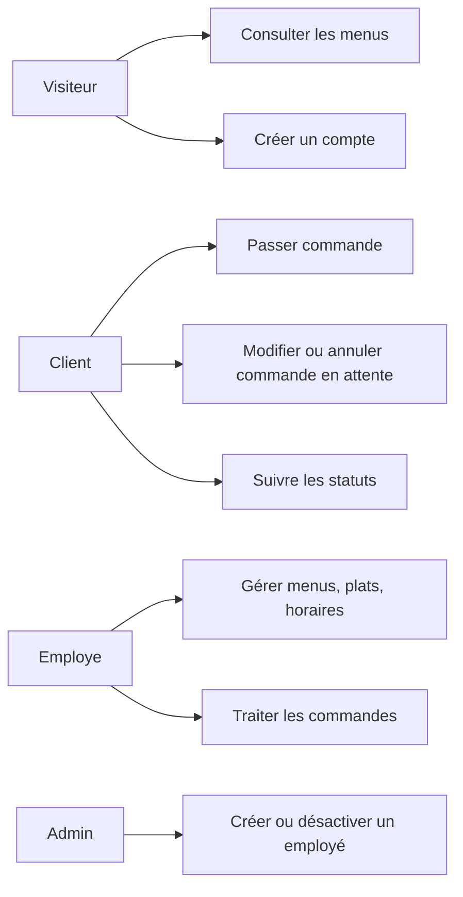

# Architecture technique — Vite & Gourmand (état de la version 2)

## Choix techniques

- HTML5/CSS3 responsive et JavaScript natif : peu de dépendances, faible coût d'hébergement et filtres de menus côté client.
- PHP 8.2 et PDO : intégration directe avec Apache/XAMPP, requêtes préparées, logique métier et autorisations côté serveur.
- MariaDB/MySQL : données structurées (menus, plats, relations N:N, commandes, comptes, suivi et avis).
- Session PHP et cookie HttpOnly / SameSite : authentification côté serveur, sans stocker de jeton dans le navigateur.
- MongoDB/NoSQL : **non intégré**, exigence à réaliser pour le graphique des commandes par menu.

## Entités principales et relations



## Cas d'utilisation (extrait)



## Séquence de commande (extrait)

```mermaid
sequenceDiagram
    actor Client
    participant Web as Interface web
    participant PHP as Contrôleur PHP
    participant SQL as MariaDB
    Client->>Web: Remplit le formulaire
    Web->>PHP: POST place_order + CSRF
    PHP->>PHP: Vérifie session, date, convives, livraison
    PHP->>SQL: BEGIN; SELECT menu FOR UPDATE
    SQL-->>PHP: Prix, préavis et stock
    PHP->>PHP: Calcule remise et total
    PHP->>SQL: INSERT commande + historique; décrémente stock
    PHP->>SQL: COMMIT
    PHP-->>Web: Redirection vers Mon compte
    Web-->>Client: Affiche le récapitulatif
```

## Sujets de sécurité

Les formulaires POST utilisent un jeton CSRF ; les données envoyées sont vérifiées côté PHP ; les écritures SQL utilisent des requêtes préparées ; les mots de passe sont hachés ; une session est régénérée à la connexion ; les pages de gestion et les actions vérifient le rôle ; les sorties HTML sont échappées.

**À approfondir avant déploiement** : anti-bruteforce, tests RGAA, mailer SMTP, récupération du mot de passe, stockage sécurisé des secrets, HTTPS obligatoire, protection contre l'énumération de comptes et revue des mentions légales.
